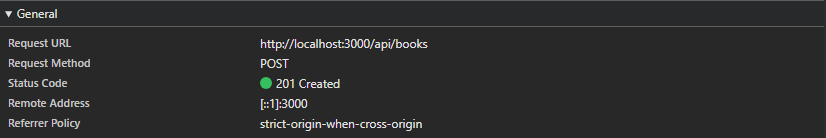
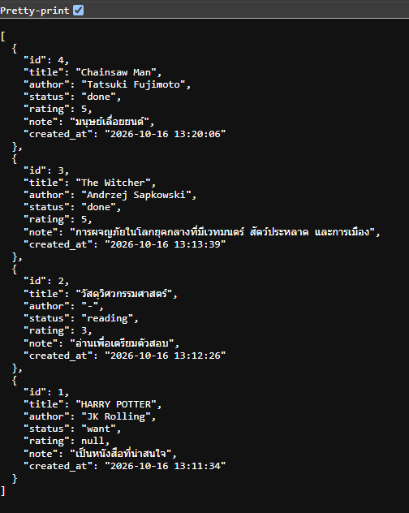

# ชั้นหนังสือของฉัน (Reading List)

Mini Project #2 — เว็บแอปพลิเคชันสำหรับจดรายการหนังสือที่อยากอ่าน กำลังอ่าน และอ่านจบแล้ว
เพิ่ม / ดู / แก้ไข / ลบ หนังสือได้ และกรองตามสถานะได้ ข้อมูลทั้งหมดเก็บในฐานข้อมูล SQLite

## เทคโนโลยีที่ใช้
- Backend: Node.js + Express
- Database: SQLite (ผ่านไลบรารี `better-sqlite3`) — ไฟล์ฐานข้อมูลถูกสร้างอัตโนมัติที่ `server/books.db`
- Frontend: HTML + CSS + JavaScript (ไม่ใช้เฟรมเวิร์ก) เสิร์ฟจากโฟลเดอร์ `public`

## โครงสร้างโปรเจกต์
```
reading-list/
├── package.json
├── README.md
├── server/
│   ├── index.js          # เริ่มเซิร์ฟเวอร์ Express
│   ├── db.js             # เชื่อมต่อฐานข้อมูล + สร้างตาราง books
│   └── routes/
│       └── books.js      # endpoint ทั้งหมดของ /api/books
└── public/
    ├── index.html
    ├── style.css
    ├── app.js            # เรียก API ด้วย fetch
    └── screenshots/      # ภาพหลักฐานการดีบัก
```

## วิธีติดตั้ง
ต้องมี Node.js 18 ขึ้นไป
```bash
npm install
```

## วิธีรัน
```bash
npm run dev
```
จากนั้นเปิด http://localhost:3000

(รันแบบปกติ: `npm start`)

## ตารางฐานข้อมูล `books`
| คอลัมน์ | ชนิด | รายละเอียด |
|---|---|---|
| id | INTEGER | primary key, เพิ่มอัตโนมัติ |
| title | TEXT | ชื่อหนังสือ (จำเป็น) |
| author | TEXT | ผู้เขียน (จำเป็น) |
| status | TEXT | `want` / `reading` / `done` (ค่าเริ่มต้น `want`) |
| rating | INTEGER | 1-5 หรือ null |
| note | TEXT | บันทึกสั้นๆ |
| created_at | TEXT | เวลาที่เพิ่มข้อมูล |

## รายการ Endpoint
| Method | Path | คำอธิบาย | Status code |
|---|---|---|---|
| GET | `/api/books` | ดึงรายการทั้งหมด (ตัวเลือก `?status=want\|reading\|done`) | 200 |
| GET | `/api/books/:id` | ดึงหนังสือเล่มเดียว | 200, 404 |
| POST | `/api/books` | เพิ่มหนังสือ | 201, 400 |
| PUT | `/api/books/:id` | แก้ไขหนังสือ (ส่งเฉพาะฟิลด์ที่ต้องการแก้ได้) | 200, 400, 404 |
| DELETE | `/api/books/:id` | ลบหนังสือ | 204, 404 |

ตัวอย่าง body สำหรับ `POST /api/books`:
```json
{ "title": "ผู้ชายขายเสียง", "author": "ตัวอย่าง นามสมมติ", "status": "reading", "rating": 4, "note": "อ่านถึงบทที่ 3" }
```

## ภาพหลักฐานการดีบัก
### ภาพที่ 1: POST /api/books (Status 201 Created)


### ภาพที่ 2: GET /api/books แสดงข้อมูลที่บันทึกในฐานข้อมูล

